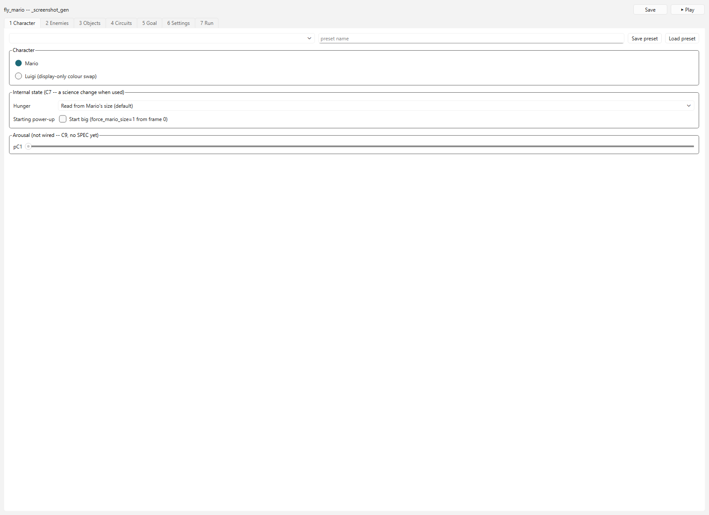
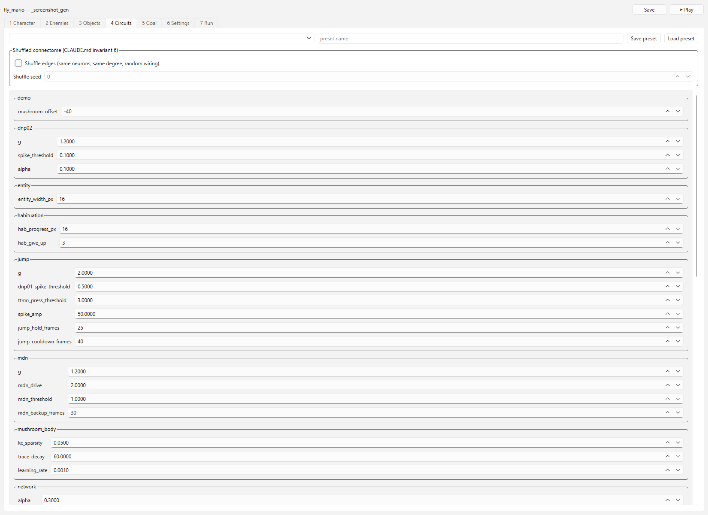
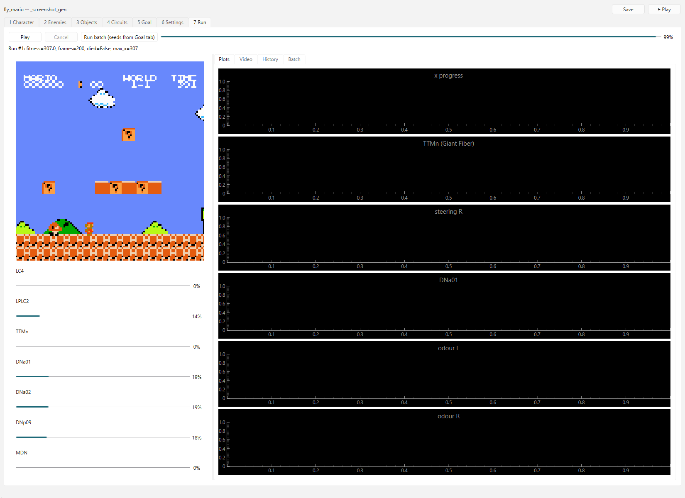

# fly_mario tool

Status: P0-P5 done, P7 polish landed (live-preview fps throttle, keyboard
shortcuts, per-tab presets, run bundle export, screenshots below). See
`PLAN.md` for the full plan and phase history, `CODEBASE_CHANGES.md` for
every change made outside `tool/` to support it.

## Install

```
pip install -r requirements.txt          # from the repo root
pip install -r tool/requirements.txt     # PySide6, pyqtgraph, pytest-qt, pytest-timeout
```

## GUI

```
python -m tool
```

Opens the project gate (new / duplicate / open / recent -- cannot be
skipped), then the main window: header (project name, dirty marker, Save,
Play) and seven tabs (Character, Enemies, Objects, Circuits, Goal,
Settings, Run). Play spawns a worker process and streams the live
preview (the raw game frame, recoloured for Luigi, plus per-population
telemetry bars) back to the Run tab; Cancel stops it. See `PLAN.md`
section 5 for which controls are `live` vs `not wired` today.

Keyboard shortcuts: Space plays, Esc cancels, Ctrl+S saves -- from
anywhere in the window (tool/PLAN.md P7).

**Character tab** -- Mario/Luigi (a display-only colour swap), C7's
hunger override and starting power-up, and a per-tab preset bar (save/load
this tab's own settings as a named preset, `tool_presets/character/`):



**Circuits tab** -- every one of `config/params.py`'s 49 scalars
(`schema.py`), plus C5's shuffled-connectome control:



**Run tab** -- live preview (throttled by Settings' "Live preview fps",
P7) with telemetry bars, live plots, run history, and an "Export bundle"
button (config + telemetry CSV + video + note, zipped) for a selected
history entry:



Regenerate these with `python -m tool.scripts.gen_screenshots` (needs a
real Qt platform -- not `QT_QPA_PLATFORM=offscreen`, which has no fonts).

## Command line

Everything `tool/core` can do, it can also do from the command line, no
GUI needed -- useful for batches or CI:

```
# create a project (projects/<name>/, holding config.json + tool.json)
python -c "from tool.core.project import ToolProject; ToolProject.create('my_project')"

# run one seed
python -m tool.core.cli run my_project --seed 3

# run several seeds, in parallel (a warm worker pool -- see PLAN.md P2)
python -m tool.core.cli batch my_project --seeds 0 1 2 3 --workers 4
```

Each run is recorded in `projects/<name>/tool_runs/index.json` (number,
seed, git commit, fitness, and the full `RunSpec` needed to reproduce it)
and gets its own `projects/<name>/runs/NNN_slug.md` (setup and numbers
auto-filled; add the "what we learned" line yourself -- the tool never
touches `docs/RUNS.md`).

## Layout

See `PLAN.md` section 3 for the full intended layout.

```
tool/
  __main__.py         python -m tool -- launches the GUI
  core/                NO Qt imports -- fully testable headless
    project.py         ToolProject: create/open/duplicate/save
    tool_settings.py   CharacterSettings, CircuitSettings, FitnessSettings,
                        ExperimentSettings, RenderSettings
    schema.py          all_controls(): every one of config/params.py's 49
                        scalars as a ControlSpec (range, provenance, wiring)
    wiring.py          live/partial/not_wired status for non-scalar controls
    run_spec.py        RunSpec: one frozen object, one run, reproducible
    runner.py          RunSpec -> run_steering.main(), via
                        sim.project_runner.run_from_config;
                        run_one_streaming for the GUI's Play/Cancel
    run_store.py        NNN numbering (never reused), tool_runs/index.json,
                        projects/<name>/runs/NNN_slug.md, export_run_bundle
    presets.py           named per-tab snapshots, tool_presets/<tab>/<name>.json
    batch.py            seeds x episodes, a warm multiprocessing.Pool
    fitness.py          thin wrapper over sim.fitness for a finished run
    palette.py           Mario<->Luigi colour swap, display-only
    cli.py               python -m tool.core.cli run|batch
  ui/
    app.py               QApplication + the project gate
    gate.py               new / duplicate / open / recent
    main_window.py        header + seven tabs; Play/Cancel via a shared
                          multiprocessing stop Event; Space/Esc/Ctrl+S
    widgets/
      param_form.py       schema-driven Circuits form, greyed if not live
      preview.py           live frame + palette.py + telemetry bars
      plots.py             pyqtgraph telemetry plots
      preset_bar.py         save/load row, shared by every preset-bearing tab
    tabs/                  character.py enemies.py objects.py circuits.py
                          goal.py settings.py run.py
  scripts/
    gen_screenshots.py    regenerates docs/screenshots/*.png (needs real fonts)
  tests/                   pytest tool/tests/ -- separate from the repo's
                          own golden gate (pytest tests/), its own
                          pytest.ini (180s default timeout)
```
